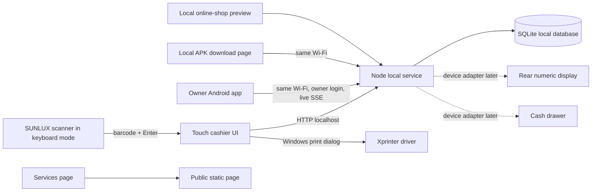

# PromedPara v2 architecture

## Goals and requirements

- Run the cashier workflow on the existing Windows touchscreen till.
- Accept scans from the SUNLUX reader in USB keyboard mode, with large touch targets and a scanner field that regains focus.
- Print a sale receipt through the installed Xprinter Windows driver.
- Keep inventory, suppliers, staff permissions, and sales in durable storage.
- Give the two owners a responsive phone dashboard and live sale events.
- Keep the public services website separate from the private POS.
- Keep the rear numeric display and cash drawer behind device adapters because their make/model, connector, and protocol are not yet known.

## Component map

## Data ownership and access

SQLite on the till is the source of truth while offline. The USB launcher sets `PROMEDPARA_DATA_DIR` to `%LOCALAPPDATA%\PromedPara\data`, so the app files can run from a USB folder while the database remains on the workstation drive. Staff can create sales; an owner can separately grant the `can_receive_stock` permission, which only allows supplier stock receipts. Product setup, price changes, imports, supplier editing, reports, and account management remain owner-only. Employee accounts can be badge-only; owner accounts require a password. Passwords use Node's `scrypt`; session cookies are HTTP-only and same-site. Sale creation and stock decrement share one SQLite transaction.

Each employee phone is enrolled with an owner-issued one-use pairing code (random 48-bit value, five-minute expiry, hash stored in SQLite). Each phone receives its own random TOTP secret. The Android worker app encrypts that seed with AES-GCM using a key held by Android Keystore, renders a Code 39 barcode containing `PP + device ID + six-digit TOTP`, and refreshes every 30 seconds. The scan endpoint allows a small clock-skew window, rate-limits attempts, records each accepted time step to prevent replay, and creates a cashier session. Owners can revoke enrolled devices. Pairing, permission changes, and revocation are recorded in the owner notification log.

The local event stream sends sale, stock-receipt, and low-stock-crossing events to the owner Android app. The app uses an Android foreground service with a visible status notification and native notifications; it also reads a sequence-numbered local event history to catch up after a brief disconnect. The phone stores only its server address, session cookie, and event cursor; it does not open or host the SQLite database. Notification delivery requires the app's monitoring service, the workstation, and the phone to remain available on the shop Wi-Fi. Android can still suspend background work under battery restrictions.

## Device boundaries

- Scanner: treat the SUNLUX as a keyboard-wedge scanner. Scan input is tested through the ordinary focused barcode field.
- Xprinter: use the operating system print dialog and installed printer driver. Confirm its roll width at the till.
- Rear numeric display: the photo shows a seven-segment numeric display at `0.00`; protocol and port are unknown. Do not send guessed serial/USB commands.
- Drawer: no open pulse is sent until we confirm whether it is connected to the Xprinter kick port or the terminal and identify its command/settings.

## Data model

- `users`: owner/cashier role, username, scrypt password hash.
- `worker_devices` and `worker_pairings`: enrolled Android badges, replay counter, and expiring pairing-code hashes.
- `worker_recovery_codes`: hashed employee fallback codes with a 10-minute expiry and one-use timestamp.
- `product_imports`: source-file hash and import summary to prevent reimporting the same CSV.
- `business_settings`: WhatsApp contact and customer-facing delivery note for the shop preview.
- `products`: barcode, SKU, category, stock quantity, reorder level, sale and cost prices in integer centimes, supplier reference.
- `suppliers`: contact, phone, email, category, notes.
- `sales` and `sale_lines`: immutable sale header and line snapshots, payment, cashier, total, received and change.
- `stock_movements`: receipts, sale decrements, catalogue imports, and manual adjustments.
- `notifications`: owner-facing sale and stock events.

## API boundary

- `GET /api/status`, `POST /api/setup`, `POST /api/login`, `POST /api/logout`, `GET /api/me`
- `GET /api/products`, `POST /api/products`
- Owner-only `POST /api/products/import/preview` and `/api/products/import/commit`; CSV is held in memory for up to 30 minutes before owner confirmation, and only the confirmed commit writes rows.
- Public `GET /api/shop/products` returns active product names, sale prices, categories, and a boolean availability flag. It never returns purchase costs or exact quantities. `GET /api/shop/config` returns the public WhatsApp number and delivery note; owner-only `GET/POST /api/shop/settings` manages them.
- `POST /api/sales`, owner-only `GET /api/sales` and `GET /api/overview`
- Owner-only `POST /api/suppliers` and `GET/POST /api/team`; a stock receiver can read supplier choices and post receipts only.
- `POST /api/worker/enroll`, `/api/worker/scan-login`, and rate-limited `/api/worker/recovery-login`; the owner can issue one-use recovery codes for active cashier accounts.
- Static `/shop` and `/services` customer pages; the online-shop cart hands off a message to WhatsApp and does not reserve inventory or process payment.
- Owner-only `GET /api/events` using server-sent events and `GET /api/notifications?afterSeq=<rowid>` for reconnect catch-up.
- Local `GET /owner-app` and `/worker` install pages, plus `GET /PromedPara-Owner.apk` and `/PromedPara-Worker.apk` downloads.

## Trade-offs and next revision

This local-first build works without a cloud account and keeps cashier data on the till. The Android service can notify the owner while the app is backgrounded as long as monitoring remains active, Android permits the foreground service, and both devices stay on the local network. It does not provide alerts while the phone is away from the shop Wi-Fi. The hardware step is to capture the terminal model/port details and the Xprinter/drawer connection before adding device-specific commands.
